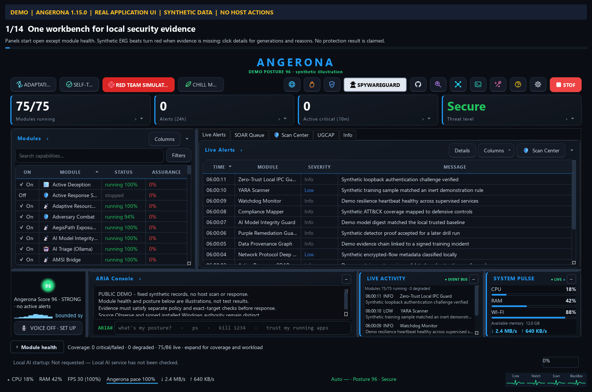
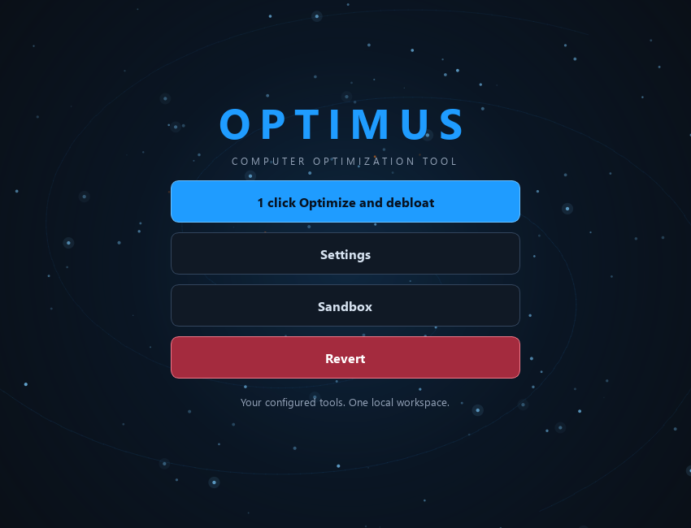
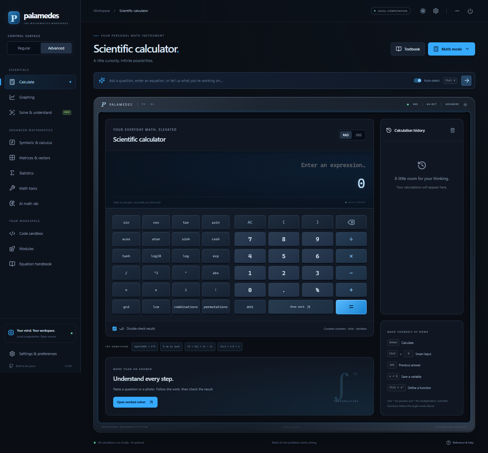

# Angerona · Optimus · Palamedes UI Design Bundle

A reusable collection of the original interfaces, themes, custom widgets, window effects, loading animations, icons, and visual references from three local projects. Captured **November 2, 2026**.

Start with the [visual gallery](gallery/index.html), [motion catalog](docs/MOTION-CATALOG.md), or [implementation guide](docs/IMPLEMENTATION.md). Each project contains source snapshots, integration examples, design tokens, an effect inventory, license notices, and a SHA-256 extraction manifest. Personal details and local paths are scrubbed; see the [public privacy policy](docs/PRIVACY.md).

| Project | Design and effects | Start here |
| --- | --- | --- |
| **Angerona** | Dark security workbench; cyan panel accents; animated telemetry, holographic orb, radial menu, window mask reveal/reverse close, orb collapse/restore, shark and swords indicators. Includes the richer AngeronaSuite and the smaller legacy dashboard. | [Source, examples, effects and provenance](projects/angerona/README.md) |
| **Optimus** | Cyber maintenance console; starfield; custom header/window controls; animated window mask reveal/reverse close; global and local loading indicators; preserved historical UI variants. | [Source, examples, effects and provenance](projects/optimus/README.md) |
| **Palamedes** | Instrument enclosure, tactile keys, Cyber / Slate / CRT skins, configurable backlight, boot/shutdown, standby, workspace transitions, orbit loader, modal and mobile navigation. | [Source, examples, effects and provenance](projects/palamedes/README.md) |

## Visual references

### Angerona



### Optimus



### Palamedes



More screenshots, live effect studies and animation links are in the [gallery](gallery/index.html). Captions distinguish existing upstream demonstrations, new UI-only captures, and browser adaptations of native motion.

| Animation recording | What it shows |
| --- | --- |
| [Angerona effects playground](projects/angerona/media/demo/effects-playground.gif) | Synthetic showcase of preserved Qt presentation components. |
| [Optimus window and loading effects](projects/optimus/reference/showcase-effects.gif) | Actual Qt reveal masks and widgets composited offscreen; starfield and loaders. |
| [Palamedes power sequence](docs/animations/palamedes-power.gif) | Browser startup and shutdown from the source renderer's visual states. |

## Quick start

The gallery needs no packages. Open `gallery/index.html`, or serve it locally:

```powershell
python tools/serve_gallery.py
```

Then visit `http://127.0.0.1:8099/gallery/`. The gallery runs locally and does not start any source application's services.

For **Qt / PySide6**, use the Angerona and Optimus `showcase.py` entry points and their project guides. They exercise original presentation components with synthetic content. For **React**, start with [Palamedes' namespaced effects](projects/palamedes/reusable/README.md), or run its complete original renderer:

```powershell
node projects/palamedes/reusable/prepare-preview.mjs ../palamedes-ui-preview
cd ../palamedes-ui-preview
npm ci
npm run dev
```

Copy the smallest component and its documented dependencies into a new project, keep the attribution, and replace application data/actions with your own. The [implementation guide](docs/IMPLEMENTATION.md) maps common goals to concrete files.

The preview preparation applies a documented [React storage-effect compatibility fix](projects/palamedes/reusable/STORAGE-EFFECT-FIX.md) in a separate copy. The source snapshot keeps the original behavior for reference.

## What the collection preserves

- Authored UI code, styles, paint routines, vector/raster assets, original dependency declarations, and supporting helpers needed to understand UI imports.
- Startup, shutdown, window reveal and close, progress and busy indicators, panel transitions, telemetry art, themes, typography, and interaction details present in the located source.
- Source snapshots tracked by published hash and, where redacted, original hash, plus separate adaptations for reuse and UI-only showcases.
- Historical variants where their UI bytes differ, with provenance rather than repeated identical distributions.

The per-project guides state what was found and what remains unverified. Palamedes' renderer shutdown enters standby; its native Electron close has no custom tween. The small legacy Angerona dashboard hides to tray on close and has no authored opening tween. Full original application screens may depend on application-specific models or services; the showcases are the standalone reuse entry points. This is a source snapshot, not a binary distribution or an assertion that every full application is independently runnable from the bundle.

Credentials, local user histories, live telemetry databases, application engines, caches, virtual environments, installers and installed dependencies are excluded. Some original renderer code retains optional user-triggered integrations for source fidelity; the isolated effects do not need them.

## Verify and archive

```powershell
python tools/validate_bundle.py
python tools/build_catalog.py
python tools/make_archive.py
```

See [validation results](docs/VALIDATION.md), [source provenance](docs/PROVENANCE.md), and [third-party notices](THIRD_PARTY_NOTICES.md). The collection's documents/examples and each preserved source retain their applicable licenses; the Optimus raccoon media has a separate notice. Keep those notices when reusing assets.
