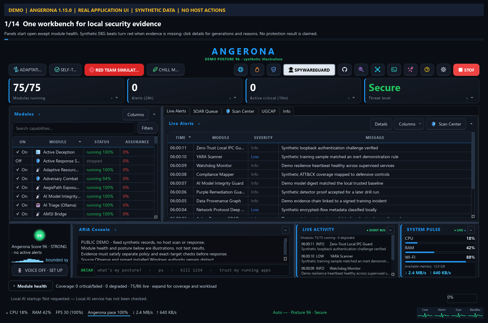
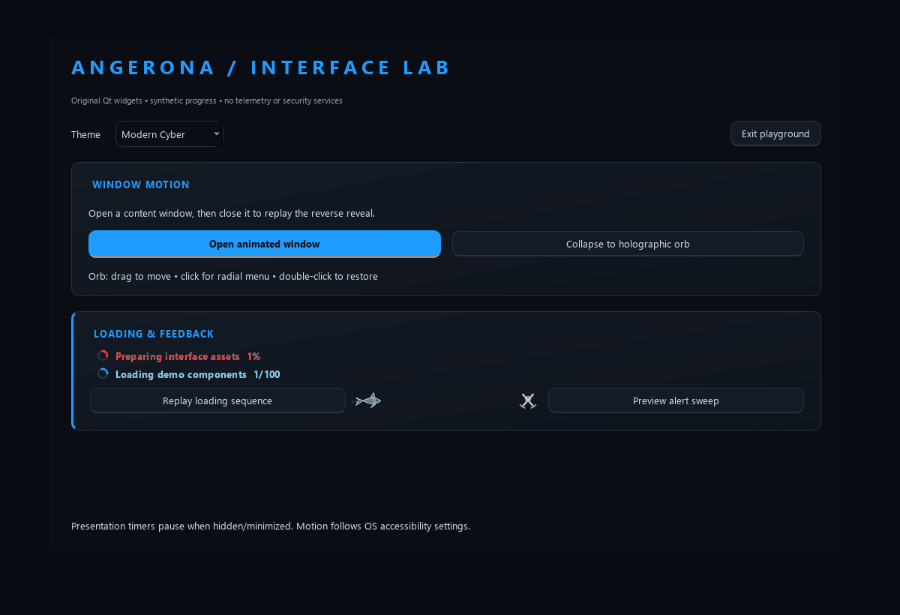

# Angerona UI collection

This folder preserves the Angerona 1.15.0 desktop interface from the primary **AngeronaSuite** source tree (`angerona-primary` in the manifest). A smaller earlier tree is preserved under `legacy/` (`angerona-legacy` in the manifest); it has a much simpler interface. Machine-specific source paths are omitted from this public collection.

**Framework:** Python 3.10+ and PySide6 / Qt 6. **Original license:** MIT, retained in [`source/LICENSE`](source/LICENSE) and [`legacy/LICENSE`](legacy/LICENSE). UI sources, SHA-256 hashes and original relative paths are recorded in [`extraction-manifest.json`](extraction-manifest.json). Unchanged files retain their original bytes; privacy substitutions retain a separate `original_sha256` when applied. Machine-specific source-root paths use aliases. The new playground and these notes are bundle additions.





## Run the effect playground

From this folder, with Python and PySide6 installed:

```powershell
python -m pip install -r requirements-showcase.txt
python showcase.py
```

The playground loads the extracted original `PanelRevealOverlay`, `HolographicOrbController`, `RunSpinner`, `GlobalLoadingIndicator`, vector shark, clashing swords and alert overlay. Its alert-overlay adapter uses an ASCII `!` glyph: headless Qt color-emoji font discovery stalled at the original shark label's `adjustSize()` on this machine. The inherited sweep, flash, paint and completion methods are unchanged; the archived original still uses its shark glyph. Its data and actions are synthetic. The full Angerona application entry point is not loaded. The four orb service nodes restore the playground, so they cannot start service monitors. Use **Exit playground** to quit; the window's X follows Angerona's original collapse-to-orb behavior.

To capture only the playground without a visible window:

```powershell
$env:QT_QPA_PLATFORM = 'offscreen'
python showcase.py --screenshot media/screenshots/effects-playground.png
```

For a short recording of the original open/close masks, orb collapse/restore and loaders, install Pillow and run `python showcase.py --record media/demo/effects-playground.gif`. The recorder composites only its own synthetic widgets and their live masks; it never records the desktop. The mask and trail geometry comes from the extracted original classes. Window decoration is omitted from this composited recording. OS reduced-motion preferences still apply.

The dashboard and other retained full-app screenshots were published-demo assets in the source project's `assets/screenshots` directory. They are preserved reference media. The playground image and effects GIF are newly captured from the extracted widgets with synthetic data. An optional credits screenshot and full original GIF were omitted from this public bundle because they display third-party author identities; required license notices remain intact.

## Original window opening, closing and minimize effects

| Effect | Exact source location | Behavior / timing |
|---|---|---|
| Open a real content window | [`header_controls.py:499`](source/src/angerona/gui/header_controls.py#L499), `_start_target_reveal` at line 1015 | A narrow 4 × 28 px starting mask expands into the actual destination window; an accent frame follows it. 360 ms, `OutCubic`. No screenshot substitute is used. |
| Close the same window | [`header_controls.py:1048`](source/src/angerona/gui/header_controls.py#L1048) | Intercepts the real close request once, reverses the mask, then performs the real close. `max(90, round(320 * current_progress))` ms, `InCubic`; a close during opening reverses from the current progress. |
| Install across an application | [`header_controls.py:1243`](source/src/angerona/gui/header_controls.py#L1243) | `install_global_window_reveal(owner, config=...)` shares one coordinator; newly shown content windows receive opening and reverse-close motion. `show_with_window_reveal` at line 1267 also reveals a standalone first window. |
| Main-window X / minimize to orb | [`main_window.py:6419`](source/src/angerona/gui/main_window.py#L6419), [`holographic_orb.py:1169`](source/src/angerona/gui/holographic_orb.py#L1169) | Main close is ignored, the main UI hides, and a holographic outline shrinks toward a draggable orb. The controller also observes minimize events. The original tray fallback remains in source. |
| Outline collapse / reverse restore | [`holographic_orb.py:133`](source/src/angerona/gui/holographic_orb.py#L133) and `restore_window` at line 1209 | `CollapseTrail`: 440 ms, `InOutCubic`, first compressing the window to a vertical line, then moving the line to the orb; restore reverses the geometry. A 750 ms grace guard prevents presentation failure from indefinitely hiding a window. |
| Orb radial menu | [`holographic_orb.py:274`](source/src/angerona/gui/holographic_orb.py#L274) | Translucent, frameless spinning globe; draggable anchor; inward-facing service moons; hover and cached status labels. Menu expansion: 260 ms, `OutCubic`; decorative tick: 50 ms. |
| Window sizing / lifetime | [`window_controls.py`](source/src/angerona/gui/window_controls.py), [`window_fit.py`](source/src/angerona/gui/window_fit.py) | Fullscreen/escape handling, work-window registry, refresh/lifetime ownership and fitting to the usable desktop. These are functional support, rather than additional visual transitions. |

`motion_allowed` in `header_controls.py:442` honors `ANGERONA_REDUCE_MOTION`, `config.ui_motion_enabled`, and Windows' client-area animation accessibility preference. Keep that policy when reusing effects. The main window marks its opening as reveal-only so that reverse-close masking does not compete with the orb collapse.

## Loading, activity and feedback animations

All of the following original implementations are retained in [`animations.py`](source/src/angerona/gui/animations.py):

| Component | Source line | Detail |
|---|---:|---|
| `_SpinRing` | 39 | A 105° rounded arc over a faint ring, advancing 11° every 33 ms. |
| `RunSpinner` | 162 | Determinate percentages move red → amber → green. Estimated work eases toward 95% until completion. `finish()` holds 100% for 1500 ms, then hides. Despite the original comment saying “fade,” this final disappearance is a hide, with no opacity animation. |
| Global loading bus | 290 | Thread-safe begin/update/finish tokens; `loading_activity` context manager. |
| `GlobalLoadingIndicator` | 344 | 140 ms reveal delay avoids short-operation flicker; overlapping work is counted so one finishing job cannot hide another active job. |
| `HeaderActivityLane` | 137 | Collapses the header activity row only when both indicators are idle. |
| `MicMeter` / `_LevelBar` | 471 / 520 | Smoothed green → amber → red level bar with fast attack, slower release and held peak. Feed a synthetic or application-provided level; no microphone access is needed for rendering. |
| `ThreatOverlay` | 560 | 1500 ms shark-glyph sweep with a red flash, reduced by 0.04 every 40 ms. |
| `SharkSwimIndicator` | 618 | Vector shark swims, turns, bobs and leaves bubbles; 33 ms tick. |
| `SharkSwimBanner` | 747 | Larger vector shark crosses the top of the window, 50 ms tick. |
| `ClashingSwords` | 873 | Vector blades clash with sparks only while active, 40 ms tick. |

[`presentation_timer.py`](source/src/angerona/gui/presentation_timer.py) suspends presentation wakeups while widgets are hidden, tabs inactive, or windows minimized. It uses the retained [`background_pacing.py`](source/src/angerona/core/background_pacing.py) controller for optional pressure/chill pacing. Neither file starts a host sampler. Retain the visibility and teardown handling when moving these effects into a new app.

## Visual design and other retained surfaces

The whole primary `src/angerona/gui/*.py` layer is preserved, not just selected examples. This includes:

- **Theme system:** [`theme.py`](source/src/angerona/gui/theme.py): Cyber, Retro CRT and Dark Slate palettes; configurable accent, scaled typography and spacing; translucent painted gradients; accent-edge cards; zebra/hover/selection tables; visibly depressed button states. Scale is clamped to 0.75–1.35.
- **Vector icon system:** `header_controls.py` draws the distinctive navigation icons through QPainter; no external icon font is required. Brand and tray icons are in `source/assets/icons/`.
- **Dashboard:** `main_window.py`, `pages.py`, `dashboard_sections.py`, `dashboard_details.py`, `dashboard_footer.py`, `orbital_dashboard.py`, `aria_hud.py`, `component_heartbeat.py`, `live_defense_activity.py`, `system_pulse.py`, `top_talkers.py`, `response_status.py` and `ollama_status.py`.
- **Threat / investigation views:** `attack_heatmap.py`, `worldview_page.py`, `threat_intel_page.py`, `incident_timeline_page.py`, `sentinel_lens.py`, `aegis_path.py`, `cve_analysis_window.py`, `alert_preview.py`, `breach_display.py`, `selftest_results.py`, `aar_history.py` and `resolve_center.py`.
- **Workflow panels:** Scan Center, Spyware Guard, Operations Center, Prevention, Recovery, UGCAP, fleet, detection forge, adaptation workbench, GitHub tools, storage/telemetry controls, red-team console, engine console, sandbox editor and upgrade console.
- **Dialogs / onboarding:** setup wizard, guided tour, AI consultation, USB approval and analysis-lab setup dialogs.
- **Other app surfaces:** `source/blackbox_recorder.py` contains the original Black Box interface and recorder context; `source/src/angerona/resilience/status_ui.py` contains service-monitor UI; `source/flow_canvas.html` preserves the original HTML security flow canvas. These are archived source contexts and are not started by the playground.

The full application screens depend on domain models and backend services that are deliberately outside this UI extraction. They are reference implementations for porting: a new project must replace those imports and callbacks with its own model and actions. `source/requirements.txt` and `source/pyproject.toml` are preserved dependency references; installing their complete backend dependency set is unnecessary for the effect playground.

## Reuse recipes

For a new **Qt** app, begin with `theme.py`, `header_controls.py`, `animations.py`, `holographic_orb.py` and `presentation_timer.py`. Keep the small `core/eventbus.py` enum dependency or replace `Severity` with your own enum, and keep `background_pacing.py` or provide the same timer pacing interface. The included playground demonstrates this boundary with the originals unchanged.

```python
from angerona.gui.theme import build_qss
from angerona.gui.header_controls import install_global_window_reveal
from angerona.gui.animations import RunSpinner, begin_loading, finish_loading

window.setStyleSheet(build_qss("cyber", accent="#38bdf8", scale=1.0))
window.reveal = install_global_window_reveal(window)
window.spinner = RunSpinner(window)
window.spinner.start("Importing")
window.spinner.set_progress(40, 100)
window.spinner.finish("Ready")
token = begin_loading("Loading local records")
# Finish the actual task, then:
finish_loading(token)
```

Own the reveal coordinator and orb controller for the lifetime of the application; call their `shutdown()` methods before Qt tears down native widgets. Keep QApplication ownership of the controllers and preserve the opt-out flags for popups and purpose-built orb surfaces. Replace Angerona-specific service callbacks and filenames before distributing your new app.

For a **web / Electron** project, port the design values and finite geometry to CSS/canvas: Qt QSS is not CSS, and Qt's `#AARRGGBB` colors use a different alpha order from CSS hex. Treat the recorded durations/easings and source paint formulas as the behavioral reference. No web rewrite in the bundle should be mistaken for an original Angerona implementation.

## Coverage and provenance limits

The extraction includes all primary GUI modules found at the source path, brand icons, selected public-demo media, security-flow diagrams, the three secondary source contexts above, and the complete small legacy GUI. It excludes runtime databases, host logs, alerts, credentials, environments, build output and backend engines. The public-demo screenshots cover selected application screens; they do not prove every window's current runtime behavior. Animation statements above come directly from the copied source. Current SHA-256 values verify bundle integrity; original fingerprints preserve provenance for files with privacy substitutions. These checks do not establish full application equivalence.
