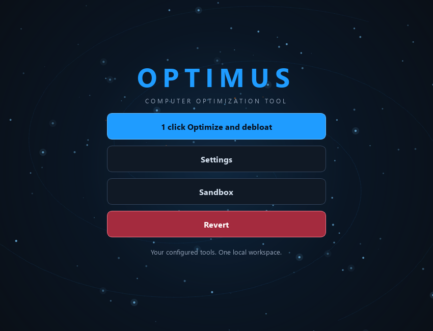

# Optimus UI design collection

Primary source: local Optimus **0.12.31**, `source://optimus/Releases/0.12.31/source`. Older local releases and Desktop backups are indexed in [variants/index.json](variants/index.json). Original program code uses MIT; keep [source/LICENSE](source/LICENSE), [source/NOTICE](source/NOTICE), and the Angerona attribution in `source/src/optimus/widgets/LICENSE-Angerona.txt`.



## What is preserved

- `source/src/optimus/widgets/`: the original Qt UI primitives, theme engine, responsive layouts, vector icons, loading rings, local GIF player, worker grids, scroll navigation, full-screen controls, tooltips, dialogs, and panels.
- `source/src/optimus/ui.py`: full UI composition, including the animated spiral starfield, dashboard, settings, worker cards, progress dialogs, and review windows. `native_ui.py`, `onboarding.py`, and `self_update_ui.py` preserve additional composition.
- Other Python modules in `source/src/optimus/` preserve imports needed to understand integrated UI behavior. They are archived application source. The showcase imports rendering widgets only; no application entry point or maintenance engine runs.
- `source/src/optimus/assets/`: SVG/ICO identity, checkbox artwork, loader code and attribution. Original third-party character art is omitted; the player accepts an optional custom asset.
- `reference/`: selected screenshots and design documentation shipped with the source distribution, plus new clean synthetic showcases. Original captures containing non-open artwork are omitted. These are original reference captures, not newly verified recordings of 0.12.31. The extraction manifest identifies their origins.
- `variants/objects/` plus `variants/index.json`: every byte-unique UI/asset revision found across the indexed local distributions. These preserve earlier visual treatments without repeating identical files for every release.
- `effects.json` and `design-tokens.json`: machine-readable effect and design catalogs.

## Reuse the actual effects

Use Python 3.11+ with `PySide6>=6.6,<7`. Rendering primitives need Qt only; the full archived application declares additional dependencies in `source/pyproject.toml`.

```powershell
python -m pip install "PySide6>=6.6,<7"
python showcase.py
python showcase.py --screenshot reference/showcase.png
```

For headless capture, set `QT_QPA_PLATFORM=offscreen`. Mask-based native-window reveal may have platform differences under the offscreen plugin; inspect it interactively on the destination platform before shipping.

`record_effects.py` additionally uses Pillow to encode `reference/showcase-effects.gif`. It renders the original Qt widgets and composites the dialog through its **actual live reveal mask**, with a clear offscreen label. `reference/showcase-effects.json` records the mask bounds per frame, so opening and closing coverage can be checked. The recording does not claim to capture the Windows desktop compositor.

The safe showcase combines the **original** theme, vector navigation button, window-reveal coordinator, progress indicators, local GIF loader, and an extracted copy of `StarfieldCanvas`. It uses synthetic values and has no system-maintenance callbacks. `reusable/starfield.py` contains the extracted original rendering class with only its rendering imports, so it can be copied into a new Qt project without importing the integrated application.

### Window opening and closing

Copy `header_controls.py`, `button_tooltips.py`, `window_geometry.py`, and their relative widget imports. Preserve the licenses. Install one coordinator on your top-level window:

```python
from types import SimpleNamespace
from optimus.widgets.header_controls import install_global_window_reveal

window.config = SimpleNamespace(ui_motion_enabled=True)
window.reveal = install_global_window_reveal(window, config=window.config)
# The action must show and return the actual destination widget.
button.clicked.connect(lambda: window.reveal.reveal(button, open_dialog, "#1f9cff"))
```

`open_dialog()` creates/shows/returns a `QDialog` parented to the owner. Keep Python references to dialog and coordinator. The open animation expands a real-content `QRegion` mask from the source origin in **240 ms / OutCubic**, painting an accent border. Close reverses the mask in up to **180 ms / InCubic**, then invokes the destination's real close handler. Close vetoes, queued dialogs, previous masks, geometry bounds, and shutdown cleanup are handled in the original coordinator. Call `coordinator.shutdown()` before application teardown. Main application close logic has additional workflow cancellation rules; do not transplant those business actions into a generic UI.

`OPTIMUS_REDUCE_MOTION=1`, `config.ui_motion_enabled=False`, or the Windows client-area-animation preference disables the decorative reveal. Tooltips, menus, splash surfaces, and `QMessageBox` are intentionally excluded by the current coordinator. `_optimus_no_reveal` opts a widget out; `_optimus_reveal_open_only` disables reverse-close interception for a destination.

### Loading and progress

`RunSpinner.start(label)`, `.set_progress(done, total)`, and `.finish()` show a rotating 105-degree arc colored red → amber → green. Estimated mode uses a quadratic ease to 95%; call `.finish()` on actual completion. Although its source comments say “fade,” the current `finish()` implementation holds green for **1500 ms** and then hides; no opacity tween is implemented there.

`WorkerActivityRing.set_progress(percent, health, active=True, phase=...)` shows measured progress, or an indeterminate rotating arc when `percent=None`. `CompactWorkerActivityRing` reuses this behavior in tighter cards. Set data from your own worker model.

`LocalLoadingAnimation` plays the bundled local GIF with `QMovie`, validates decoding budgets, pauses while hidden/minimized, and uses a static poster when motion is disabled. It is decorative; progress comes from the separate bars/rings. The **raccoon GIF and PNG are not MIT-licensed**. Their original `RACCOON-NOTICE.txt` preserves creator/source/terms and hashes. Replace them with assets you can use in your new project if needed.

### Theme and layout

Copy the `widgets` package and `assets/checkbox-check.svg`. `build_qss('cyber' | 'crt' | 'slate', accent=None, scale=1.0)` supplies the three palettes, gradients, button push depth, focus/hover/selected states, cards, zebra tables, progress bars, chips, scrollbars, and form controls. Eight-digit QSS colors are **#AARRGGBB**, unlike CSS alpha-last notation. Scale is clamped to 0.75–1.35. Use the original object names (`Brand`, `Panel`, `Card`, `Primary`, etc.) so the QSS selectors apply.

`FlowLayout` wraps controls; `ResponsiveWindowScale` adjusts typography/layout after window changes; `WorkerGrid` reflows worker cards; `WindowGeometryCoordinator` restores in-session geometry and keeps content on screen. These are distinct from animation.

## Source effect map

All line numbers below refer to the 0.12.31 source snapshots (with documented publication redactions) under `source/src/optimus/`.

| Effect / design | Source |
| --- | --- |
| Vector navigation icons, hover definition cards, pointer cursor | `widgets/header_controls.py:72`, `:204`, `:210` |
| OS/user/environment motion gate | `widgets/header_controls.py:360`, `:375` |
| Accent reveal border and real-content window mask | `widgets/header_controls.py:389`, `:432`, `:881` |
| Reverse close and real close-handler continuation | `widgets/header_controls.py:911`, `:1007` |
| Global dialog coordination and standalone window reveal | `widgets/header_controls.py:1091`, `:1121` |
| Animated spiral starfield, twinkling particles and radial glow | `ui.py:1697` (`reusable/starfield.py`) |
| Progress color interpolation and rotating spinner | `widgets/loading.py:21`, `:26`, `:90` |
| Bounded local GIF playback + static reduced-motion poster | `widgets/local_loading.py:38` |
| Indeterminate/determinate worker rings and phase labels | `widgets/live_activity.py:15`, `widgets/compact_worker_ring.py:41` |
| Cyber, CRT and Slate themes + custom accent + tactile buttons | `widgets/theme.py:43`, `:107` |
| Flow layout and window scaling | `widgets/flow_layout.py:6`, `widgets/responsive.py:45` |
| Responsive worker board and grid | `widgets/worker_grid.py:8`, `:99` |
| Geometry coordination and screen bounds | `widgets/window_geometry.py:85`, `:248` |
| Full-screen routing/control | `widgets/fullscreen.py:16`, `:87` |

## Historical designs

```powershell
python materialize_variant.py
python materialize_variant.py Optimus-v0.1.0-backup --output .local/optimus-0.1-ui
```

The historical index maps each source-relative file to a SHA256 object. Reconstruct one version into an empty folder to inspect its UI revision. Older UI files can depend on matching backend APIs; they are source references rather than standalone applications. `source/` is the coherent latest snapshot; use that for new integrations. Executables, Qt runtime binaries, engine PowerShell scripts, live state, logs, credentials, build caches, and installed dependencies are outside this UI bundle.

The historical **holographic orb** is a distinct design worth reusing: a translucent floating globe with pulsing glow, globe grid, scanning sweep, orbital dot, drag positioning, and service nodes. Its menu expands in 260 ms / OutCubic; a separate click-through collapse/restore trail uses 440 ms / InOutCubic and a completion guard. It is preserved at `variants/objects/67bc7bd066c333778f6bf3dfff474e1a5e5984baca92e13655d7fb96c06d4497/holographic_orb.py` (classes at lines 117 and 258). Materialize the 0.4.0 backup to inspect its matching header dependencies. Both Native-C import Sandbox snapshots were compared against that backup and contain byte-identical UI/assets.

The original `reference/media/manifest.json` identifies the labelled media set as **0.12.24 mock-backend QWidget captures**, with simulated metrics and no host-maintenance operations. This provenance is retained alongside the GIF and MP4.

## Verification scope

`extraction-manifest.json` records published SHA256 hashes, pre-redaction hashes where changed, and aliased source origins. The catalogs describe source-established behavior. Original screenshots/recordings document prior captures; their exact release/runtime settings are not inferred. No dedicated splash-screen effect or custom cursor artwork was identified in the latest UI: the loader, spinner, starfield and window reveal are separate components. Runtime capture of the isolated showcase is reported by the bundle's validation documentation.

## Open-source publication exclusions

The original third-party raccoon GIF/poster and reference captures containing them are omitted because no open redistribution license was supplied. The optional local GIF player, its attribution/source notice, and a custom asset slot remain. New showcase PNG/GIF captures use original Qt progress rings. Historical source objects keep their pre-redaction identifiers; their index verifies published bytes with updated SHA256 fields. See [the collection omission inventory](../../docs/media-omissions.json) and [privacy policy](../../docs/PRIVACY.md).
